

  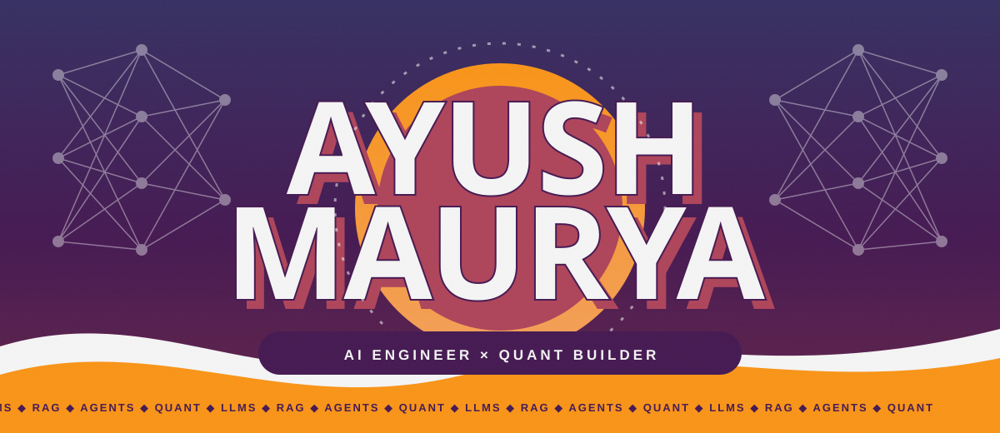
    
  
  
  

 

  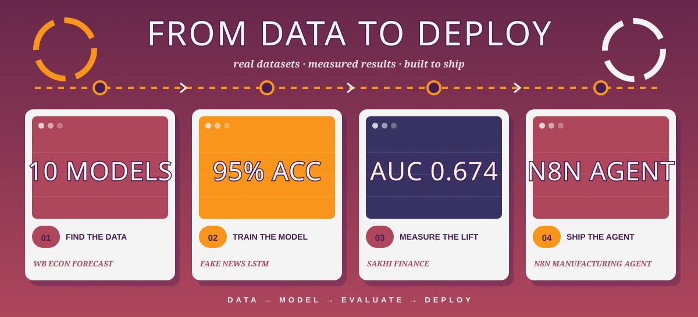

 

<h2 align="center">SELECTED WORK · THE REEL</h2>

<i>Click a poster and step inside the build.</i>

  <a href="https://github.com/DrustO9/Sakhi_finance">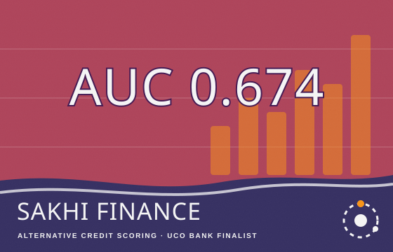</a>
  <a href="https://github.com/DrustO9/spam-email-classifier">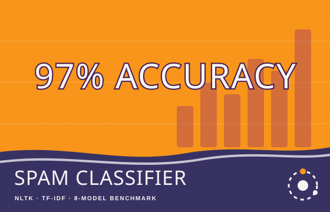</a>

  <a href="https://github.com/DrustO9/fake-news-lstm">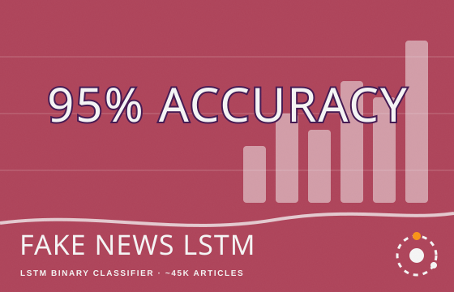</a>
  <a href="https://github.com/DrustO9/wb-econ-forecast">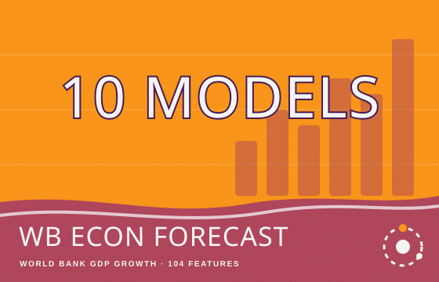</a>

  <a href="https://github.com/DrustO9/empathy-resilience-model">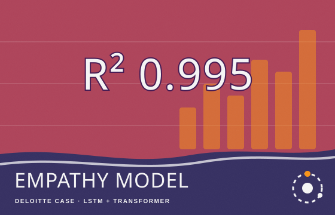</a>
  <a href="https://github.com/DrustO9/n8n-manufacturing-assistant-agent">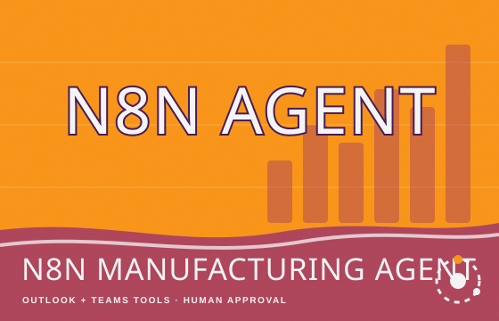</a>

 

  

 

  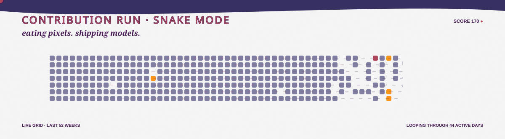

 

  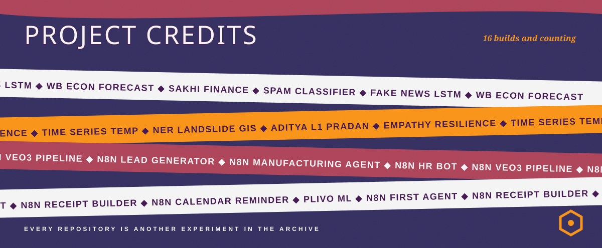

  
<b>OPEN THE COMPLETE SOURCE INDEX</b>

   

| Project | Portal |
| :--- | :---: |
| **Sakhi Finance** | [Code](https://github.com/DrustO9/Sakhi_finance) |
| **spam-email-classifier** | [Code](https://github.com/DrustO9/spam-email-classifier) |
| **fake-news-lstm** | [Code](https://github.com/DrustO9/fake-news-lstm) |
| **wb-econ-forecast** | [Code](https://github.com/DrustO9/wb-econ-forecast) |
| **empathy-resilience-model** | [Code](https://github.com/DrustO9/empathy-resilience-model) |
| **time-series-temp** | [Code](https://github.com/DrustO9/time-series-temp) |
| **NER_Landslide_GIS** | [Code](https://github.com/DrustO9/NER_Landslide_GIS) |
| **aditya-l1-pradan-download** | [Code](https://github.com/DrustO9/aditya-l1-pradan-download) |
| **n8n-manufacturing-assistant-agent** | [Code](https://github.com/DrustO9/n8n-manufacturing-assistant-agent) |
| **n8n-ms-teams-hr-bot** | [Code](https://github.com/DrustO9/n8n-ms-teams-hr-bot) |
| **n8n-veo3-video-to-youtube** | [Code](https://github.com/DrustO9/n8n-veo3-video-to-youtube) |
| **n8n-google-maps-lead-generator** | [Code](https://github.com/DrustO9/n8n-google-maps-lead-generator) |
| **n8n-first-ai-agent-demo** | [Code](https://github.com/DrustO9/n8n-first-ai-agent-demo) |
| **n8n-whatsapp-receipt-builder** | [Code](https://github.com/DrustO9/n8n-whatsapp-receipt-builder) |
| **n8n-calendar-appointment-call-reminder** | [Code](https://github.com/DrustO9/n8n-calendar-appointment-call-reminder) |
| **plivo-ml-23CH3FP43** | [Code](https://github.com/DrustO9/plivo-ml-23CH3FP43) |

 

  
    
  

